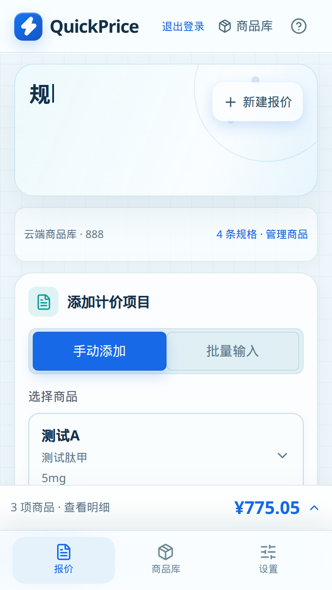
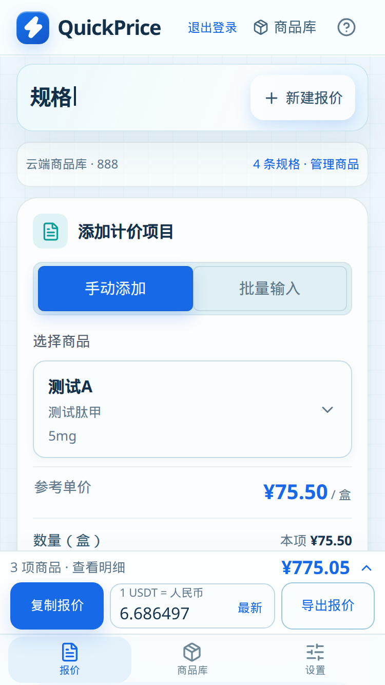

# QuickPrice 第一阶段审查

审查范围：只读代码、在本机独立测试库上做功能验证，并记录问题。没有修改业务代码，没有部署，没有连接或写入生产商品库（`http://106.14.116.244/` 与 `/var/lib/quickprice` 均未访问）。

审查日：2026-10-13。基线：`main` @ `e0811f6`。

## 架构

QuickPrice 是一个登录后使用的商品报价工具。浏览器是 React 19 单页工作台（`app/quickprice-app.tsx`、`components/`），服务端是 Vinext/Vite 打成的 Cloudflare Worker，本地与阿里云都用 Wrangler/Miniflare 里的 D1（SQLite），不是托管的云端 D1。

| 层 | 职责 |
| --- | --- |
| `app/page.tsx`、`app/login/` | 未登录跳转登录；账号固定为 `888` / `account:888` |
| `app/api/catalog` | 整份商品 JSON 的读取与带版本号的整表保存 |
| `app/api/exchange-rate` | 登录后返回 USDT/CNY 参考价，`Cache-Control: private, no-store` |
| `lib/pricing.ts`、`lib/quote-export.ts` | 分（人民币）精确计价、USDT 半入取整、复制文本与 CSV |
| `lib/rate-service.ts` | 60 秒缓存、定时报价、过期与失败回退 |
| `db/`、`drizzle/` | `catalogs`、`auth_sessions`、`login_attempts`、`exchange_rate_cache` |

当前报价清单只在浏览器内存里，离开页面前要自行复制或导出。商品库按账号整表保存，多设备共享同一份 `account:888` 数据。

## 生产部署

线上入口是阿里云上海服务器的公网 IP，Nginx 监听 80，反向代理到 `127.0.0.1:3000` 的 `quickprice.service`（独立用户、开机自启）。没有 TLS。Nginx 把 `hotfix/quickprice-hotfix.css` 和 `hotfix/quickprice-hotfix.js` 注入页面：CSS 负责手机操作栏避让，JS 在非安全上下文里用 `document.execCommand('copy')` 复制。

发布方式是本机 `npm ci` 与 `npm run build`，上传 `dist`，短暂停服务后切换目录。不在 1 GiB 的服务器上构建。数据目录 `/var/lib/quickprice/v3/d1/`、密码文件 `/etc/quickprice/runtime.env` 和备份目录不随构建覆盖。GitHub 不自动部署，也不回写云端商品修改。原 Sites 站点仍留在 `.openai/hosting.json`，与这台服务器的库不同步。

workerd 在这台 glibc 2.32 的机器上靠兼容库和 `SSL_CERT_FILE` 做 TLS 校验，用来访问行情源。

## 商品数据

商品不是逐行表，而是 `catalogs.products_json` 里的一整份 JSON，另有 `revision` 和 `updated_at`。

- `GET /api/catalog`：要登录。没有记录时返回空数组和 `revision: 0`。
- `PUT /api/catalog`：要登录、同源 `Origin`、JSON。`revision === 0` 时插入；否则必须命中当前版本，成功后版本 +1。并发写入返回 409，不能强制覆盖。
- 单次正文上限约 1.5 MB，最多 2000 条。校验简称、名称、规格、单位、两位小数单价和别名。
- 历史文件 `data/catalog-2026-09-20.json` 不是当前线上库。本次测试没有导入它。

本地测试库是 Miniflare 的 SQLite（`.wrangler/state/v3/d1/`，已 gitignore）。按 `drizzle/0000` 到 `0003` 建表。账号 `888` 的密码哈希只写在未提交的 `.dev.vars`。

## 欧易汇率

浏览器只请求同源 `/api/exchange-rate`，不直接访问交易所。

1. **来源。** GitHub Actions（`.github/workflows/okx-rate.yml`）用托管 runner 读取欧易公开接口 `https://www.okx.com/priapi/v3/growth/convert/detail?baseCurrency=USDT&quoteCurrency=CNY`。`scripts/fetch-okx-rate.mjs` 校验业务码、USDT/CNY、价格、上游缓存时间和响应大小；最多 3 次、单次 8 秒、总预算 27 秒。成功后只更新 `rate-feed` 分支的 `okx-usdt-cny.json`。`rawRate` 保留原始精度，展示和计算用 6 位小数 `rate`。`fetchedAt` 是取数成功时间，不是成交时间。失败不改旧文件。
2. **刷新。** 定时 cron 是每小时的 2、7、12……57 分，GitHub 可能排队，不能当成实际频率。上海服务器的 `rate-watchdog.py` 每 2 分钟检查；报价达到 4 分钟时用专用 deploy key 推 `rate-refresh` 分支触发补取，两次触发至少相隔 4 分钟。页面可见时每 60 秒读本站接口。点击「最新」带 `refresh=1`，绕过本站 60 秒缓存，重新读已经发布的文件，不会当场跑 GitHub 取数。
3. **缓存。** 进程内成功结果缓存 60 秒。成功报价写入 D1 `exchange_rate_cache`，键为 `USDT-CNY:okx-scheduled-v3`，读写各最多等 150 毫秒。浏览器另存 `localStorage` 键 `quickprice:last-usdt-cny-market-rate:v2`。两端都拒绝超过 24 小时的值，也拒绝 CoinGate。
4. **失败回退。** 欧易报价达到 10 分钟：优先再取 KuCoin `https://api.kucoin.eu/api/v1/prices?base=CNY&currencies=USDT`，响应里标明实际来源。KuCoin 也失败则把原欧易报价标为 `kind: stale`，最多用 24 小时内的值，不改获取时间，不填固定汇率。GitHub 两个通道（raw 与 Contents API）都失败且没有可用欧易缓存时，同样走 KuCoin。全部失败且没有缓存时接口返回 503，页面允许手填。

本机可以访问欧易接口、KuCoin 和 GitHub `rate-feed`。测试服务读到的实时报价是 `6.686497`，`fetchedAt` 为 `2026-10-13T09:26:00.616Z`，来源为欧易定时报价。失败回退另外用 mock 跑过，见 `evidence/rate-fallback.log`。

## 测试环境

- Node.js 22.14.0，`npm ci`，`npm run dev` 监听 `http://localhost:3000`（实际绑在 IPv6 localhost）。
- 本地 D1，空商品库起步，只写入审查用样品（测试肽甲、边界半分、`=1+1`、多肽「报价」）。
- `.dev.vars`、`.wrangler/` 未提交。仓库和工作区环境文件里没有生产主机或生产密码。
- 单元测试：`node --test tests/*.test.mjs` 在 22.14 上因不能加载 `.ts` 而失败。加上 `--experimental-strip-types` 后 77 通过、2 跳过（集成测试和参考 Excel 未设置环境变量）。
- 浏览器：本机 Chrome，桌面 1440×900；手机 375×667 与 390×844，并打开触摸与 `pointer: coarse`。分别测了源码样式，以及注入 `hotfix/quickprice-hotfix.css` 之后的样式。

## 通过的检查

- 登录后才能读商品库和汇率；未登录商品接口 401。错误密码 401。用过期版本保存商品返回 409。
- 页面上可以新增商品并出现在报价里。新建报价会先确认，再清空当前清单。
- 复制文本包含中文品名、人民币金额、逐行 USDT 和合计。文件名形如 `多肽报价清单_2026年10月13日_09时32分.csv`。
- 导出 Blob 的前三个字节是 `EF BB BF`（UTF-8 BOM）。中文「测试肽甲」「多肽「报价」」在 CSV 中可读。以 `=` 开头的品名被写成 `'=1+1`，避免表格公式。
- 人民币按分计算。`0.01 / 2` 的一半分位进成 `0.01` USDT；`0.01 / 3` 为 `0.00` USDT。`151.00 / 7.2 = 20.97`，`31.50 / 7.2 = 4.38`（恰好 0.005 进位），`1234.56 / 7.2 = 171.47`。示例清单合计 `¥775.05 / 7.2 = 107.65`。
- 7 位小数和 `0` 被拒绝。汇率 `0.000001` 时 `0.01` 元折合 `10,000.00` USDT。
- 手改汇率后，自动轮询和迟到的接口响应不会盖掉手填值。点击「最新」恢复已发布的欧易报价，获取时间仍是文件里的时间。
- 注入 hotfix 之后，375×667 和 390×844 上「复制报价」「最新」「导出报价」的点击落点在按钮上。商品库对话框铺满视口，没有超出屏幕。
- 桌面 1440×900 没有横向溢出。

## 问题

严重程度按对报价正确性、能否完成操作、以及凭据暴露来排。

### 1. 高 — 源码里的手机操作栏被底部导航挡住，复制、导出和「最新」点不到

- 位置：`app/globals.css` 在 `max-width: 740px` 时把 `.action-bar` 设为 `position: fixed; bottom: 0; z-index: 30`。`.mobile-nav` 也是 `position: fixed; bottom: 0; z-index: 40`。避让只写在 `hotfix/quickprice-hotfix.css`，不在应用构建里。
- 复现：用源码开发服务器，375×667 或 390×844（触摸、粗指针），加入至少一行报价。底部导航盖住操作栏整行（重叠高度 68px）。`elementFromPoint` 落在 `mobile-nav-item` 上，点不到复制、导出和「最新」。
- 期望：这三个按钮可点，且不被导航遮住。
- 实际：未注入 hotfix 时不可点。把 hotfix CSS 加到页面之后，375×667 的操作栏 `bottom` 变为 50px、`z-index` 变为 41，390×844 的 `bottom` 为 68px，三个按钮都能点到。
- 证据：`evidence/m375-before-hotfix.png`、`evidence/m375-after-hotfix.png`、`evidence/m390-after-hotfix.png`、`evidence/mobile-hit-test.json`。
- 说明：线上 Nginx 目前会注入这份 hotfix，所以现网若注入仍在，用户看得到修好的布局。应用源码本身没有这个修复。下次构建如果漏了 Nginx 注入，手机会无法完成复制和导出。

### 2. 高 — 生产站点是明文 HTTP，会话 Cookie 在 HTTPS 上才带 Secure

- 位置：`deploy/aliyun/quickprice.nginx.conf` 只监听 80。`app/account-auth.ts` 的 `cookieValue` 仅当请求 URL 是 `https:` 时才加 `Secure`。Cookie 本身是 `HttpOnly; SameSite=Lax`。
- 复现：按运维文档访问 `http://106.14.116.244/` 并登录。本次没有访问该地址；本地 HTTP 登录响应同样没有 `Secure`（本地需要这样，Cookie 才能在 HTTP 开发服务器上生效）。
- 期望：账号和会话只在 TLS 上传输。
- 实际：文档写明用户选择先用公网 IP、当前没有 TLS。同一网络上的人可以读取密码和会话。
- 证据：Nginx 配置与 `cookieValue`；本地登录响应头只有 `HttpOnly; SameSite=Lax`。

### 3. 中 — CSV 单价沿用输入原文，金额却是两位小数

- 位置：`lib/pricing.ts` 的 `quoteCsv`。金额列用 `(lineTotal / 100).toFixed(2)`，单价列直接写 `l.price`。
- 复现：报价行单价改成 `10.5`，另一行改成前有空格的 ` 75.50`，汇率 `7.2`，导出。
- 期望：单价与金额一样是去掉空白的两位小数，Excel 能当数字求和。
- 实际：CSV 中是 `" 75.50"` 和 `"10.5"`，对应金额是 `"151.00"` 和 `"31.50"`。前导空格会让表格不把该格当数字。计算本身仍按 trim 后的分值，所以金额是对的。
- 证据：`evidence/quote-sample.csv`。

### 4. 中 — USDT 逐行四舍五入后，单价乘数量、以及各行之和，可以不等于合计

- 位置：`lib/quote-export.ts` 的 `usdtAmount`。每一行的单价和金额、以及合计，都是各自的人民币金额除以汇率后半入到 0.01 USDT。说明文字写的是合计按人民币总额换算。
- 复现：
  - 单价 75.50、数量 2、汇率 7.2。单价折合 10.49，两倍是 20.98；行金额 151.00 折合 20.97。
  - 三行各 0.01 元、汇率 2。每行 0.01 USDT，三行相加 0.03；人民币合计 0.03 折合 0.02 USDT。
- 期望：若业务要核对「单价 × 数量 = 金额」，USDT 列需要能对上；否则界面对这个差额要有说明。
- 实际：复制和 CSV 都按上述规则出数，差额没有单独提示。人民币列是对齐的。
- 证据：`evidence/copied-quote.txt`、`evidence/quote-sample.csv`、`evidence/rounding-sample.txt`。

### 5. 中 — 商品库不能删除

- 位置：`components/catalog-manager.tsx` 只有新增、编辑和导入。导入合并也只新增或更新。README 写的是在线增删改。
- 复现：打开商品库，找删除商品的按钮。没有。
- 期望：可以删掉误加或停用的规格，且报价里已选的行有明确状态。
- 实际：误加的商品会留在共享库里。接口接受整表替换，所以技术上可以靠提交一份更短的列表删除，但页面没有这个操作。
- 证据：商品库界面与组件源码。本地样品是用整表替换清掉的，不是用页面删除的。

### 6. 中 — 手动汇率刷新后丢失，被上次成功的自动行情覆盖

- 位置：`app/quickprice-app.tsx`。`updateRate` 只改当前页状态，不写 `localStorage`。`rememberRate` 只在自动行情成功且未过期时写入。刷新时先读那份市场缓存。
- 复现：把汇率改成 `7.2`，确认合计已按 7.2 折算，然后刷新。
- 期望：若手动汇率表示双方约定的价格，刷新后应仍是 `7.2`，直到点「最新」。
- 实际：刷新后输入框变回浏览器里上次成功的欧易价 `6.686497`。点「最新」也会回到已发布行情。当前页内的手动保护是有效的：在请求返回前改成 `9.25`，迟到响应没有覆盖它。
- 证据：测试日志中的 persistence / late-response 步骤。当前报价清单本身也不跨刷新保存，这一点页面有说明。

### 7. 低 — 文档中的测试命令在 Node 22.14 上不能加载 TypeScript

- 位置：`README.md` 的 `node --test tests/*.test.mjs`，`package.json` 要求 Node `>=22.13.0`。
- 复现：在 22.14.0 上按文档执行。
- 期望：满足 engines 的版本能跑通测试。
- 实际：7 个导入 `.ts` 的测试文件报 `ERR_UNKNOWN_FILE_EXTENSION`。`node --experimental-strip-types --test tests/*.test.mjs` 为 77 通过、2 跳过。类型剥离在更高的 22.x 才默认开启。

### 8. 低 — 1440×900 时复制和导出在首屏下面

- 位置：桌面 `.action-bar` 是普通文档流，不是固定栏。
- 复现：1440×900，加入几行报价，停在页面顶部。
- 期望：主要操作在视口内，或有固定入口。
- 实际：空清单时操作栏大约在 y=1107；四行报价时大约在 y=1423。都低于 900px 视口，需要向下滚动。没有被别的元素挡住。
- 证据：`evidence/desktop-1440-empty.png`、`evidence/desktop-1440-actions.png`。

### 9. 低 — 响应没有 CSP 和防嵌入头

- 位置：`middleware.ts` 设置了 `X-Content-Type-Options: nosniff` 和 `Referrer-Policy: same-origin`。没有 `Content-Security-Policy`，也没有 `X-Frame-Options`。会话 Cookie 是 `SameSite=Lax`，跨站 iframe 不会带上登录态。

## 证据索引

| 文件 | 内容 |
| --- | --- |
| `evidence/desktop-1440-empty.png` | 桌面空工作台 |
| `evidence/desktop-1440-catalog.png` | 新增后的商品库 |
| `evidence/desktop-1440-new-quote-dialog.png` | 新建报价确认 |
| `evidence/desktop-1440-actions.png` | 桌面复制、汇率、导出 |
| `evidence/m375-before-hotfix.png` | 375×667，操作栏被导航盖住 |
| `evidence/m375-after-hotfix.png` | 注入 hotfix 后的 375×667 |
| `evidence/m390-after-hotfix.png` | 注入 hotfix 后的 390×844 |
| `evidence/mobile-375x667-catalog.png` | 手机商品库 |
| `evidence/mobile-hit-test.json` | 点击落点和重叠高度 |
| `evidence/copied-quote.txt` | 复制出的报价文本 |
| `evidence/quote-sample.csv` | 页面导出的 CSV 文本（经 `blob.text()` 解码，BOM 被解码器去掉） |
| `evidence/csv-blob-prefix.txt` | 下载 Blob 实际以 `EF BB BF` 开头 |
| `evidence/rounding-sample.txt` | 三行 0.01 元在汇率 2 下合计差 0.01 USDT |
| `evidence/rate-fallback.log` | mock 的失败、过期和 KuCoin 回退 |

